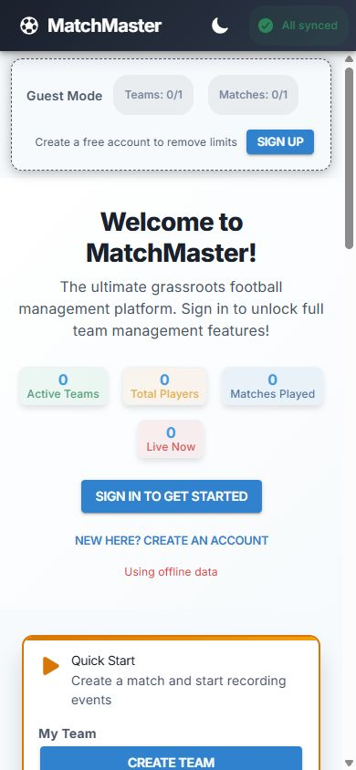
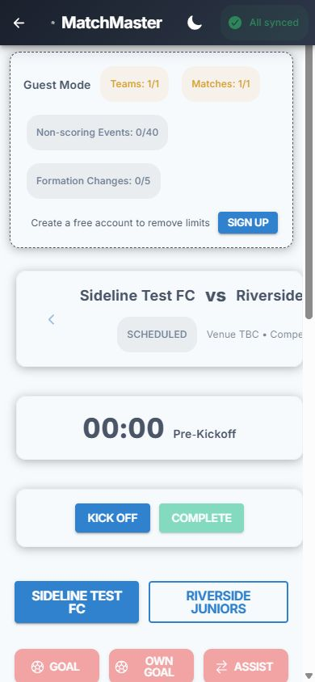
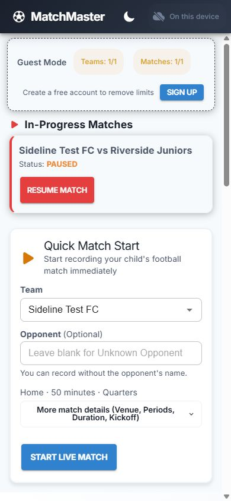
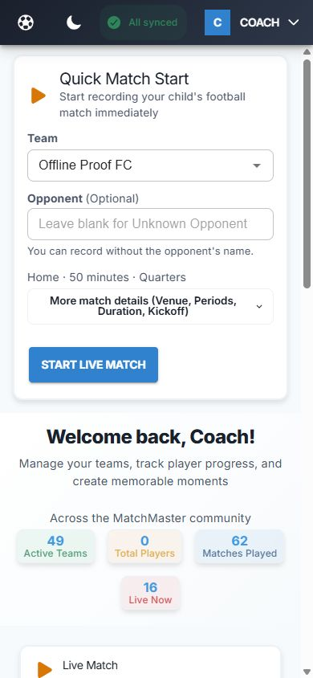
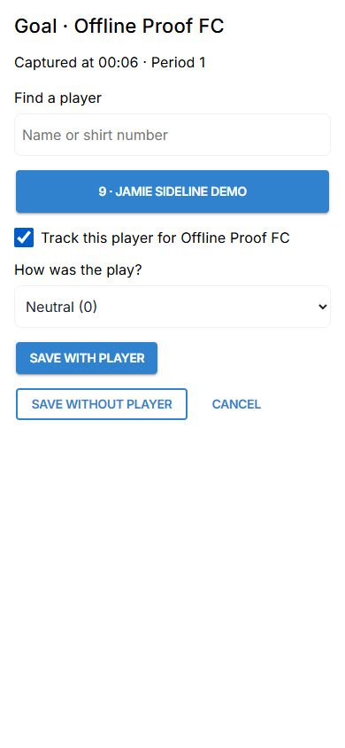
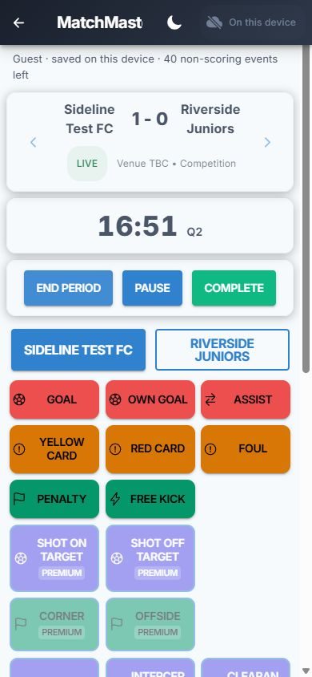
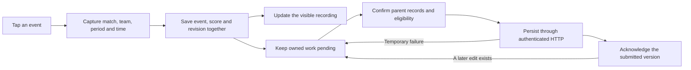
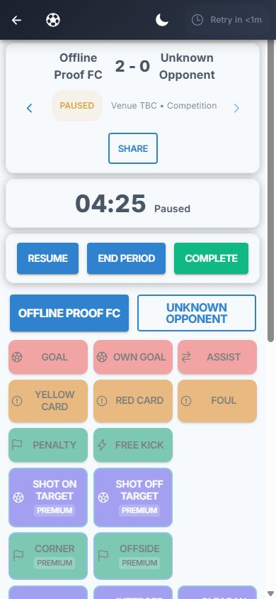

# Sideline recording assessment and improvements

14 October 2026

The primary user is a parent watching their child's football match with a phone in one hand. The website should help them enter a match quickly, record the moment without looking away for long, correct a mistake confidently, and return after a break without losing the score or clock.

The existing offline storage, configurable youth match periods, team rosters and player-linked events provide a useful foundation. The highest-impact weaknesses are where the interface appears successful but the saved record differs, and where administrative or sign-up controls interrupt recording. This work concentrates on entry, live recording and durable recovery.

## Project direction

The [August 2025 live-match roadmap](ROADMAP_LIVE_MATCH_MVP_2025-08.md) sets a target of starting in under 30 seconds, with minimal prerequisites and local recording before sign-in. The [local-first recording design](live-match-page-local-first.md) makes IndexedDB the recording source of truth and separates background delivery. Later changes add offline activity, app settings and dark-theme consistency. These support a focused match-day flow built on the existing design and storage model.

The product is broader than this parent's immediate task: it includes seasons, formations, awards, pricing and management pages. Those remain useful secondary destinations. Requiring a lineup, a cloud connection or a complete player roster before recording a team event would undermine the intended flow.

## Captured phone flow

The audit used the local application at a 390 by 844 viewport, with fabricated guest teams. These screenshots capture the existing flow before the corresponding screen repairs.

1. **Dashboard and quick start — needs improvement.** The recording form sits below a welcome message, sign-in prompts and aggregate statistics, and initially requires expanding a clickable heading. Team selection and the primary recording action need to be immediately visible; kickoff and period details can be optional adjustments.

   

2. **Match console — needs improvement.** The guest limits banner consumes much of the screen, long team names overflow the scoreboard, and many locked event buttons compete with the available actions. The score, clock, team choice and recording controls should fit a narrow phone and remain easy to interpret.

   

3. **Player attribution — needs improvement.** An empty roster produces an empty picker above unexplained numbers from minus three to three. Recording without a player is described only in a tip. The event, team and captured time should be clear, with a direct action to save without a player and a useful way to choose a frequently tracked player.

   

4. **Correction and reopening — failed in the original guest flow.** A guest goal changed the score to 1–0. Undo changed it to 0–0, but reopening restored the goal and 1–0. The handler removed the visible event without deleting its IndexedDB record. Corrections must survive reopening and only alter the visible feed after a successful saved mutation.

## Implemented improvements

The dashboard now presents Quick Start immediately, remembers a valid managed team, and puts LIVE or PAUSED matches behind a direct Resume action. Optional match details stay available without dominating the first screen. The match list uses locally saved status, so a paused match remains easy to find after its scheduled kickoff time has passed. Guest mode states clearly that recordings stay on the current device.

A fresh sign-in now fetches the parent's managed teams directly on Home. Cached teams remain usable during a slow or failed request. A production check on a fresh browser origin confirmed that the existing team appeared and Start Live Match became available without opening Teams. The importer preserves local edits, validates ownership before conversion, and rolls back if the requesting account changes during saved application.

The dashboard labels its site-wide totals as the MatchMaster community. Those public aggregates retain their existing behavior and are separate from the owned recording and team selectors.

On narrow phones, the header uses the existing football mark and retains the full app name for assistive technology. This prevents a clipped brand fragment from crowding the account and saved-work controls.

The public page now explains that the app should be opened online before taking it to the pitch, and distinguishes guest device storage from signed-in cloud sync. Absolute claims such as “No data loss, ever” were removed. Player contribution copy describes the existing event timeline, and the incomplete analytics dashboard is marked coming soon. The plan comparison reads event counts from the shared definitions, fixing its stale six-core-event claim without changing subscription rules or prices.

The recording screen fits both team names and the score at a narrow phone width. All eight ordinary recording actions appear before premium actions, with readable labels and touch targets at least 44 pixels high. The red and green event buttons use dark text after their measured light-theme backgrounds failed contrast with white text. This is a targeted correction, not a claim of full accessibility compliance. Event selection captures the time at the initial tap. The parent can search the roster, choose a child, opt into remembering that player for the team, or save without attributing the event. Rating choices have names. A failed save retains the draft for retry, and a delayed selection cannot move an event into another period or match.

Undo, event deletion and rating corrections now use saved transactions. Period controls serialize rapid taps. Clock reconstruction keeps actual playing time and excludes pauses; shortened periods do not inherit their planned duration. Local period identity survives upload and repeated requests. Server reconciliation accepts the saved offline lifecycle without inventing another kickoff or first period.

Sync acknowledgements bind to the submitted revision. An edit or deletion made during an upload stays pending. Score changes apply event deltas to the known baseline, and background refresh checks the current local record before overwriting it. These protections matter when the parent has poor reception, reopens the application, or corrects a goal while an upload is still running.

Season delivery now preserves the local season identifier and records a proven cloud identifier separately. A returning parent's automatic default can reuse the existing owned season without changing its cloud configuration. Explicit conflicting configuration remains unresolved. Match uploads, season edits and deletion, and cache refresh use that mapping consistently. Missing prerequisites defer their children before batch limits; they no longer generate avoidable permission errors. Recovery of an older blocked queue is tied to the repaired dependency.

The legacy socket receipt no longer acknowledges an upload. The client uses the canonical saved local writer, and the server rejects the old nonpersistent packet without broadcasting or confirming it. Authenticated HTTP persistence owns cloud acknowledgement. Captured account and session checks extend through the request and final saved acknowledgement or failure, while the server rejects stale lifecycle replay over POSTPONED.

New local matches save their initial SCHEDULED state in the same transaction as the match. Imported matches with missing state remain unknown until trustworthy restoration succeeds. A failed network request cannot enable a fresh kickoff. Team Changes follows the same readiness rule, and a pending formation choice cannot commit after the parent closes the dialog, changes match or account, or the match becomes read-only.

The scoreboard uses the saved match score for the recording parent. A partially cached timeline no longer resets an existing 2–1 score to the few events currently loaded; adding and undoing a goal apply changes to that baseline. Team and season limits count the current account's records, so another account's cache or a guest trial cannot consume the parent's allowance.

## Critical findings

| Area | Original cause | Required behavior |
| --- | --- | --- |
| Event timestamp | The player picker confirmation reads the current clock and period. | Capture match, team, period and time when the parent taps the event. |
| Save failure | A failed write closes the picker and discards the draft. | Preserve the draft and selection, show the error and allow retry. |
| Guest corrections | Undo and later rating changes mutate only the screen. | Persist both guest and authenticated corrections before reporting success. |
| Sync acknowledgement | Upload completion marks the current row synced, even if it changed during the request. | Acknowledge only the submitted revision; retain subsequent edits and deletion. |
| Period replay | Starting a match creates a first server period, then sync tries to start another. | Replay a logical period once, preserve local identity, and make retries safe. |
| Offline completion | Only the final local status remains; replay can try to complete a scheduled server match. | Reconcile the saved periods and valid state transitions before acknowledging completion. |
| Playing time | Period duration uses wall-clock time, including pauses; online hydration can reset a paused clock. | Preserve explicit playing duration and separate it from scheduled period offsets. |
| Rapid taps | Lifecycle handlers allow two concurrent starts. | Serialize controls and reject a second distinct active period in persistence. |
| Match discovery | The Matches page uses an empty state list. | Keep LIVE and PAUSED matches active regardless of kickoff date, and offer direct resume. |
| Quick-start configuration | Full Match is coerced locally or rejected by the normal cloud-save schema. | Preserve quarter, half and whole formats through local creation and server sync. |
| Team identity | Name-only lookup can reuse a managed team as its own opponent. | Resolve active teams by owner and role, keeping same-named sides distinct. |
| Save status | Guest mode reports All synced without cloud storage. | Explain that guest recording stays on this device; show checking or unavailable status when evidence is missing. |
| Upgrade compatibility | Older cached child rows use synthetic creator aliases, while new writes require the actual owner. | Reclaim an alias only when the parent match proves the current account owns it. |
| Settled refresh races | Hydration protects pending rows, but an upload may settle before an old response arrives. | Check request-start evidence and the current saved recording revision at the transactional write boundary. |
| Loading race | An unresolved state query looks like a match with no saved state. | Wait for matching state and period snapshots before enabling or executing lifecycle actions. |
| Unknown saved state | A settled empty local query defaults to SCHEDULED even for a synced match whose remote status was never cached. | Distinguish trusted local creation from unknown cloud state; a failed pull must not enable a new kickoff. Preserve partial-start recovery without creating another period. |
| Historical discovery | Unvisited or purged server state is absent locally. | Keep unknown past matches discoverable without labelling them completed merely because kickoff is in the past. |
| Offline identity | Authentication initialization and refresh treat a transport failure as invalid credentials. | Preserve the previously confirmed identity and session for local recording during temporary failure; enforce actual authentication rejection and explicit logout. |
| Read-only match status | Imported CANCELLED and POSTPONED states fall back to SCHEDULED. | Preserve the actual status and prevent recording lifecycle transitions or state replay on these matches. |
| Public expectations | The landing page promises unconditional offline use and no data loss, while the comparison lists outdated event counts. | Explain first-load preparation and guest storage accurately; derive counts from the shared event definitions. |
| Account discovery | Shared local hooks return mixed cached owners; a protected Live page can still be preceded by foreign resume cards, history, activity or a stale profile label. | Filter raw ownership proof before projecting records, suppress stale account results and selections, and scope related activity joins to the current recording identity. |
| First sign-in | Home reads local teams but does not initialize them; login and cache refresh use different event names. | Fetch owned teams in the background from Home, keeping cached teams immediately usable and checking account identity during saved application. |
| Delayed formation | A dialog's asynchronous formation operation can outlive its match, account or readiness. | Capture context and validate it through the final persistence transaction; closing the dialog invalidates pending work. |
| Partial score history | Rebuilding the header solely from cached events can discard an imported score baseline. | Show the owned saved score, and apply additions and corrections as deltas. |
| Account quotas | Cached rows belonging to other accounts can consume the current account's team or season limit. | Count owned, active records and revalidate the requesting account after asynchronous checks. |
| Returning-account season | A fresh device creates a default season UUID although the same account already has that season label on the server. The season's409 is permanent, while its match and state still upload using unavailable parents. | Resolve the owned logical season safely, preserve local identity and defer dependent uploads until their prerequisites exist. Test reconnect and existing quarantine recovery. |
| Competing socket delivery | The legacy socket reconnect scans all pending events and marks them synced after a broadcast acknowledgement; the server does not persist that message. | Let confirmed REST persistence acknowledge uploads. Socket receipt cannot clear pending work or transmit guest/foreign recordings. |
| Lost create response followed by an edit | A label-only lookup no longer recognises a season after its successful create response was lost and its local label or configuration changed. | Prove the attempted same-ID cloud record, preserve the new mutation, and deliver it before acknowledging that version. |
| Edit during conflict recovery | Binding a season can confirm its parent while leaving an old permanent409 failure attached to the newer edit or tombstone. | Release the conflict that proven identity resolves, keeping the new mutation pending and unrelated denials intact. |
| Cloud configuration during lookup | A description edit while an automatic default resolves can later upload untouched default dates over the cloud configuration. | Merge the authoritative baseline with the fields actually changed during lookup; preserve explicit edits and untouched cloud settings. |

## Architecture assessment

IndexedDB should remain the source of truth for a recording parent. Network delivery is a separate concern, and temporary signal loss must not change whether a local save succeeds. Transactions are especially valuable where a correction also changes the saved match score or where a period and its current-state reference must agree.

A socket receipt is not evidence for the persistence step. A missing season or match is a dependency to resolve before its children are sent, rather than a reason to manufacture permission failures for those children.

The large Live Match page combines persistence orchestration, clock reconstruction, viewer streaming, roster controls and presentation. Extracting small timing and recording helpers makes the critical calculations testable. A broad rewrite would carry unnecessary risk; subsequent extraction should follow concrete behavioral boundaries and retain the tests added around these transitions.

The old MatchContext retains an alternative event-writing implementation, while the current Live flow uses local data-layer operations. Its imported socket singleton also reconnects automatically, so its delivery path is active even when the legacy console is not used. The independent review found that a broadcast acknowledgement could suppress durable HTTP delivery. That competing acknowledgement path belongs in this repair; further consolidation of the legacy presentation context should follow an actual consumer migration.

The fixes belong at distinct boundaries:

| Owning component | Responsibility and critical assessment |
| --- | --- |
| [Home and entry](../frontend/src/pages/HomePage.tsx) | The first screen should answer “start or resume?” immediately. Remembered defaults must be validated after asynchronous team loading and account changes. |
| [Match discovery](../frontend/src/pages/MatchesPage.tsx) | Local LIVE/PAUSED status determines active recording. Missing state is uncertainty, not evidence of completion; historical discovery must survive cache retention. |
| [Live Match](../frontend/src/pages/LiveMatchPage.tsx) | The interface owns immutable recording drafts, serialized controls and context checks. It must not enable a transition using unresolved, unknown or previous-match query results. A settled empty local state is not proof that a remote match is scheduled. |
| [Timing helpers](../frontend/src/utils/liveMatchTiming.ts) | Planned clock positions and actual playing duration are different quantities. A running anchor can reconstruct elapsed time after reopening without counting a pause. |
| [Local data layer](../frontend/src/services/dataLayer.ts) | Event, score, quota and lifecycle mutations need one saved outcome. Ownership and revision changes belong in the same transaction as the mutation. |
| [Sync service](../frontend/src/services/syncService.ts) | Delivery must acknowledge a particular revision, tolerate lost responses, and avoid letting blocked work crowd out eligible work. A successful request is not proof that a newer local edit was delivered. Owned season identity and parent eligibility precede dependent requests. |
| [Season identity](../frontend/src/services/seasonIdentity.ts) | Stable local identifiers and proven cloud identifiers serve different purposes. Resolve one exact owned logical identity, preserve explicit conflicting edits, and retain the mapping through cache refresh and subsequent delivery. |
| [Cache service](../frontend/src/services/cacheService.ts) | Refresh is a competing writer. Protection must include what was pending when the request began, as well as the record found at the final write boundary. |
| [Server state service](../backend/src/services/MatchStateService.ts) | Reconciliation must validate the imported period and lifecycle together. An ended period cannot become live merely because its identifier exists. |
| [Authentication context](../frontend/src/contexts/AuthContext.tsx) | Local recording identity and remote session validation have different availability requirements. Temporary signal loss must not clear a parent's session; cached identity must stay bound to the correct account. |

Keep the existing IndexedDB, Ionic and backend stack. Replacing the framework would not solve these transition defects. Small pure helpers and transactions provide clearer boundaries without forcing a risky application rewrite. Preserve pricing and management flows, while keeping registration, a complete roster and a starting lineup optional for the first recorded moment.

The existing frontend test suite is substantial, but passing test totals alone cannot establish lifecycle correctness. The original backend MatchStateService suite used placeholder assertions. Coupled transitions and deferred network responses need semantic assertions about periods, elapsed time, score and pending work.

One integrated independent review by Claude Opus identified additional upgrade, ownership and delayed-refresh combinations after the initial implementation passed its checks. Those claims were checked against their owning source and grouped into complete repair batches. The important lesson is to test transitions together: a pending correction, its acknowledgement, and a late stale response are one integrity case. Testing each in isolation misses the failure.

The subsequent review confirmed the repaired account, hydration and readiness boundaries, then found the competing socket acknowledgement path in unchanged code. Production acceptance also exposed the returning-account season collision, which the earlier fresh-account replay tests did not cover. Both findings were repaired together, with session checks at actual request boundaries and server protection for POSTPONED.

A targeted independent Claude Opus review of that delivery candidate found three adjacent recovery defects: a successful season create with a lost response followed by an edit; an edit or deletion during recovery of an old permanent conflict; and untouched cloud settings being replaced during a concurrent local edit. The primary substantiated all three against source and assigned one complete repair batch to the existing owner. Exact-ID ownership proof, revision-aware conflict release and field-by-field baseline merging now cover these paths. The final repair passed 121 focused tests and ten actual HTTP/database season cases. Static review and Jev evidence remain advisory: the final Jev scan was partial because of its hunk and operation limits, and does not establish exhaustive review or test success.

## Follow-up priorities

1. Add a completed-match view centred on the chosen player's recorded contributions, with links back to the source events. The current detailed statistics destinations are incomplete, so avoid presenting them as working analytics.
2. Exercise an installed iPhone Safari PWA during screen lock, app switching, low battery and loss of signal. A desktop phone-sized viewport cannot establish device lifecycle behavior.
3. Extend the demonstrated production service-worker recovery to application updates, cold launches and expired sessions on installed devices. The basic warmed-app deep-route reopening and continued recording checks passed in the desktop browser.
4. Continue accessibility checks with keyboard and screen-reader use. Visible fit and button size are useful evidence, but cannot establish full accessibility compliance.
5. Reduce repeated logic between current local writes and legacy context methods as real consumers are migrated. Extend the same ownership discipline to remaining management views and broad reference-data importers: the existing general team refresh can delete other owners' synced cache rows and lacks a session check during application. Home's narrow bootstrap avoids that importer. This assessment concentrates on the parent's Home, Matches, activity and Live journey; it is not a complete account-isolation audit of every administrative page.
6. Bootstrap the explicitly current cloud season when its label differs from the automatic local default. The repaired resolver proves exact identity or an exact owned label; it does not choose an arbitrarily differently named current season. The present behavior can create another season and consume quota. Ambiguous legacy season labels and a canonical cached alias with its own pending edit also require a deliberate conflict-resolution design.

## Validation record

Before the changes, the frontend suite had 590 passing tests, two stale expectation failures and two skipped tests. The stale expectations concerned the existing globalStats table and the existing Halves display label. Focused repairs passed all 43 related tests; five save-status tests also passed after the status changes.

The final code candidate passed all 71 frontend test files: **1,023 tests passed and two existing tests skipped**. Strict frontend source type checking and the production build passed. The backend's default non-database unit/service suite passed **208 tests in 11 files**, and shared types/transformers passed **103 tests in four files**; backend and shared builds also passed. The configured backend suite excludes its database-dependent API/integration folders by default, so those totals do not claim every backend database test ran. Backend and shared source did not change after their matching checks.

The accepted code is HEAD `3f750c72dafb9fb91cbe66ac9db40e024541bc51` plus the saved integrated code diff with SHA-256 `d3165e68af7393b98a09399fd6c532d181b04868cf95b7a44197ddeef029857d`. This identity includes new source and tests and excludes this static report and captured images. The work is local and uncommitted; no deployment or push was performed.

The acceptance checks include local correction and reload, delayed player selection, failure and retry, repeated lifecycle taps, paused playing time, local-to-cloud period replay, full-match configuration, and active-match discovery. The Home bootstrap repair passed 42 focused page, importer and discovery tests, including real IndexedDB rollback during an account change. The final frontend suite includes these tests. An outdated fake API server was corrected to issue subject-bearing tokens; production's account/profile identity check was preserved.

The real cloud checks use a disposable PostgreSQL database and fabricated accounts. They run the frontend API client, IndexedDB data layer and sync service against the application's actual HTTP routes and Prisma persistence. They are distinct from unit tests that replace network responses. They live in [frontend/tests/cloud](../frontend/tests/cloud/README.md) and run with `npm run test:cloud`, outside the default test run. Existing local databases and containers are left untouched.

All **16 actual HTTP/database replay checks** passed on the final source. Six cover same-named sides and a paused Full Match, shortened completed periods, uploaded goal undo with actual score assertions, a delayed running-clock anchor, recovery and correction of an older owned cache, and rejection of LIVE on an ended period. Ten cover returning-account season resolution, offline collision, lost create responses, old quarantine recovery, label/description/date edits after a lost response, editing or deleting during old-conflict recovery, and merging an edit with untouched cloud configuration. They assert saved identities, metadata, pending acknowledgements and dependent recording delivery. The Node/jsdom fixture uses Node-compatible abort signals so it exercises the application's real request timeout and HTTP delivery instead of failing on incompatible test-environment signal types.

A real socket client also verified that the retired upload packet receives `success: false`, with zero confirmations and broadcasts. The 17 semantic backend lifecycle tests use controlled Prisma behavior; they are separate from the 16 actual HTTP/database checks.

The read-only status repair passed 97 affected tests, including preservation of CANCELLED and POSTPONED, rejection of unsupported hydration statuses before writes, and prevention of lifecycle mutations and invalid sync uploads. Event corrections remain possible in the persistence layer; the recording interface separately controls whether a new event is appropriate for the match status.

The final production browser check used the accepted build, a fresh browser origin and a fabricated returning parent with an existing cloud team and child, Jamie Sideline Demo, shirt number 9. Home loaded the managed team without a management detour, and the first goal picker loaded the child from the existing roster. Selecting and remembering the child saved the goal with its initially captured 00:06 time, despite the clock continuing while the picker was open. The actual cloud record confirmed 1–0, the child's player ID and PAUSED at 04:18.

Both the frontend preview and backend listener were then stopped, and their absence verified. Reloading the deep match URL restored PAUSED, 1–0, 04:18 and the attributed goal with Resume available. The parent resumed with both servers still stopped: the next picker already selected the remembered child, with Save with player enabled. Saving another goal, pausing and reloading retained PAUSED, 2–0, 04:25 and both child-attributed events. After restarting the test servers, normal background delivery completed. A direct authenticated inspection of the actual cloud match, event list and state confirmed **2–0, exactly two goals, both assigned to the child's player ID, PAUSED and 265 playing seconds**. The browser then showed All synced. This used unavailable local transports; the desktop browser's network-online flag was not forced off.

| Invariant | Concrete coverage and boundary |
| --- | --- |
| A recorded moment keeps its original context | Delayed player selection, period changes, route changes, account changes, save failure and retry have focused page/helper coverage. The phone browser also shows the captured time remaining fixed while the clock advances. |
| Undo remains undone | Saved guest corrections survive reopening; authenticated goal upload followed by local undo removes the remote event and restores the remote score in the actual HTTP/database test. |
| An upload cannot acknowledge a later edit | Deferred response tests cover same-millisecond edits and deletion. Saved recording revisions also protect hydration after upload acknowledgements or row removal have settled. |
| A logical period is replayed once | Actual cloud checks cover paused Full Match replay, resume, shortened completed periods and repeated delivery. A server request to make an ended period LIVE returns 409 without changing the saved state. |
| Pauses do not add playing time | Clock and lifecycle cases cover pause, reload, resume, delayed replay, shortened periods and explicit zero duration. A delayed live anchor is preserved by actual server reconciliation. |
| One account cannot adopt another account's rows | Ownership cases cover canonical and snake-case owners, conflicting or absent ownership, legacy child aliases, foreign matches and account replacement. Reclamation requires a proven current-owned parent. |
| Unsupported work does not block eligible delivery | Queue tests put unresolved, deferred and quarantined prerequisites before eligible rows and verify that the batch limit applies after eligibility filtering. |
| New match readiness is durable | Actual IndexedDB cases cover atomic match/state creation, rollback, acknowledgement, reload and partial kickoff recovery. Page cases distinguish loading, unknown imported state, genuine remote absence and transport failure. |
| A formation stays in its captured context | Modal, API and persistence cases cover account/route changes, close/unmount, loading and unknown state, read-only statuses, and current scheduled/live/paused saves. |
| Cached timeline gaps cannot erase the score | Controlled page cases preserve an imported 2–1 baseline; persistence cases prove adding and undoing the next goal preserves the original score. |
| Fresh sign-in does not require a management detour | Actual production login on a fresh browser origin loaded the owned managed team on Home. Controlled response tests with real IndexedDB cover pagination, foreign/deleted/conflicting rows, local edits followed by ACK, stale account replies and transactional rollback. |
| A returning parent's roster is ready to record | The final production flow loaded the existing child without visiting Players, remembered the selection across a server-free reload, and persisted both goals with the exact same player ID in the actual database. |
| Identity recovery cannot discard a newer edit | Focused cases cover exact-ID validation, edits before/during lookup, account-generation replacement, old conflicts, tombstones and unrelated denial retention. Actual HTTP cases verify the delivered label, description or dates and dependent recording identities. |
| Resolving an automatic default preserves cloud settings | Deferred lookup tests and the actual HTTP concurrent-edit case assert changed fields alongside unchanged cloud dates, description and current-season configuration. |
| Socket receipt cannot falsely clear pending work | Source and local tests retain pending records through the legacy socket path; a real socket test rejects the packet with no confirmation or broadcast. HTTP and production reconnection prove durable acknowledgement. |

These results do not establish concurrent ordering across two separate devices, arbitrary server lifecycle races, compatibility with every historical record, or resilience to writers outside the supported data layer. Restoration of a deleted season with the same label was not exhaustively exercised. Ambiguous legacy identifiers remain pending instead of being silently discarded or adopted. Spectator update timing and completeness were not audited end to end.

A fully acknowledged historical recording whose state is absent cannot always be distinguished from an unvisited cloud match using the existing stored fields. An open period alone does not prove which lifecycle transition is safe. Such a record requires trustworthy restoration; it must not silently become a new scheduled match. Explicit initial state on new local creation prevents that ambiguity in the supported new-match flow.

Admin-authored state, periods or events beneath a differently owned match can also prevent automatic restoration under the current author-based ownership checks. This fails closed. Supporting that case requires a deliberate distinction between permission to view or record a match and ownership of an event's author; arbitrary foreign authors must not be silently adopted. It remains outside this repair, alongside general multi-device ordering.

Temporary validation failure preserves the saved session and recordings. Explicit logout and actual authentication rejection retain the application's existing local-cache reset behavior. Retaining unsynced records across a revoked or expired session would need a deliberate per-account recovery design; the changes do not promise recovery after logout or browser-storage deletion. Older sessions without a previously confirmed profile cache need one connected recovery before account-owned recording can resume.
