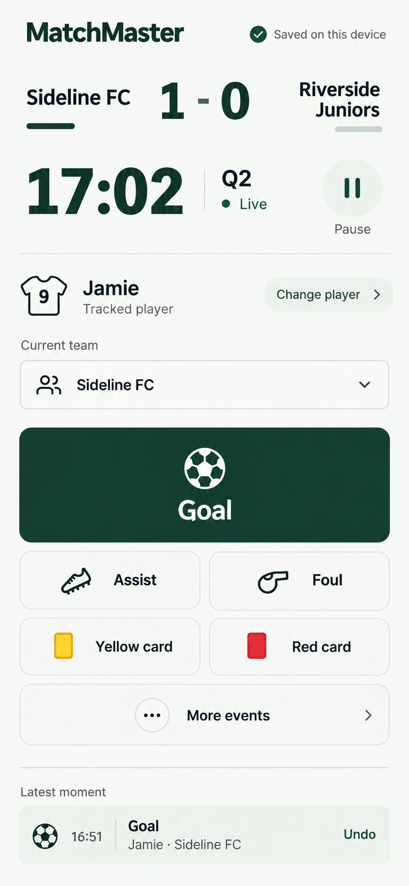

# Touchline visual system

The selected direction for MatchMaster is Touchline Daylight: a bright, restrained football recording tool centred on a parent at their child's match.

## Visual language

- Off-white page surface, forest-green actions and dark readable text.
- Inter typography, sentence-case controls and tabular match numbers.
- Grouping and whitespace before borders; lightweight dividers before elevation.
- Neutral secondary controls. Red and amber communicate actual warnings and card events, rather than decorating whole sections.
- Consistent headers, lists, inputs, dialogs and action hierarchy across the site, with compatible dark colours.
- Preserve team kit colours and meaningful pitch position colours.

| Token | Light value | Purpose |
| --- | --- | --- |
| Background | `#f8faf7` | Main page surface |
| Surface | `#ffffff` | Inputs and selected content regions |
| Ink | `#14231d` | Primary text |
| Forest | `#12392d` | Brand and primary action |
| Muted | `#56645d` | Supporting text |
| Line | `#dce4de` | Subtle separation |
| Soft | `#edf3ee` | Quiet selected state |

## Match-day hierarchy

The score and clock belong together on one open surface. The recording team and remembered child sit nearby. Goal is the clearest recording action; Assist, Foul and cards are quieter, with remaining events available through More events. End-period, completion and other occasional controls remain accessible without competing with recording.

Choosing a tracked player is a preference change, not a recorded goal. Event confirmation retains its initially captured match, team, period and time. Save, correction, ownership, authentication, quota and offline delivery behavior remain governed by the existing production data layer.

Home prioritises Start and Resume. Management, matches, account, public and pricing pages use the same shared styling and remain fully navigable. Guest storage and limits remain clear without dominating the first screen.

## Why this changes the experience

| Previous problem | Resulting design |
| --- | --- |
| Several page palettes, nested blue/indigo form themes and heavy cards made the application feel assembled from separate products. | Shared light/dark tokens now drive Ionic, Material inputs, management pages, public/account screens and modal sections. The two nested form themes inherit the common bridge. |
| Branding, save labels and quota panels competed with the score and recording buttons. | One compact header, an open scoreboard and quiet secondary controls leave the recording task in the foreground. Save status describes only what the application can prove. |
| A large inventory of coloured event buttons required scanning during play. | Goal has the largest target; Assist/Foul/cards stay nearby, and the remaining events live under More events. Entitlements still come from the existing plans. |
| A parent repeatedly selecting the same child had unnecessary work. | A visible tracked-player preference identifies the child without recording a moment. Explicit preference changes are separate from individual event attribution. |
| Correction and lifecycle actions became harder to reason about when moved around. | The redesign keeps the existing durable mutation paths and makes current readiness/recovery explicit. Period recovery, preference durability and correction states receive coupled tests. |

The existing backend, authentication, offline storage, sync, score projection, quota and timing services remain the production foundation. This change introduces no frontend dependency and no database migration.

## Verification

Implementation acceptance requires comparison with the selected image at a 390 by 844 phone viewport, checks of the surrounding pages and desktop layout, focused interaction tests, the integrated frontend suite, source type checking and a production build. Visual checks include dark mode, narrow screens, long names, open dialogs and keyboard focus. Device and cloud reliability claims remain limited to the evidence from the existing recording assessment and the checks performed for this change.

The final comparison and any accepted departures from the concept are recorded in the repository's `design-qa.md`.

The visual checks include real 390px and 360px phone layouts, a 1440px desktop layout, light/dark appearance and the actual recording/player/Undo flow. The record distinguishes those browser checks from unit tests, source checks and still-unproved physical-device or private signed-in scenarios.

Final acceptance passed:1,075 frontend tests across71 files,138 focused live/clock tests, source type checking and the production build. The accepted review findings and adjacent period boundary received coupled tests; the final local preview retained the tracked child and corrected score after reopening. See [design-qa.md](../../design-qa.md) for the screenshots, exact candidate and bounded verification claims.

The final simplify pass removed duplicate Home header styling and MUI button settings already supplied by the shared theme, preserving the approved appearance. The full frontend checks passed again. The local preview server was then stopped as requested; it can be restarted with the repository's frontend development command.
